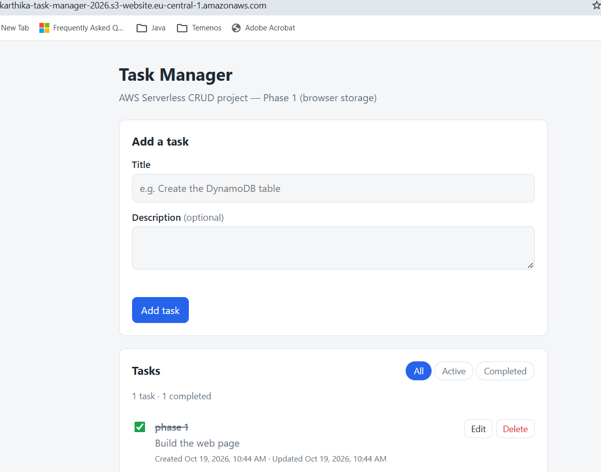
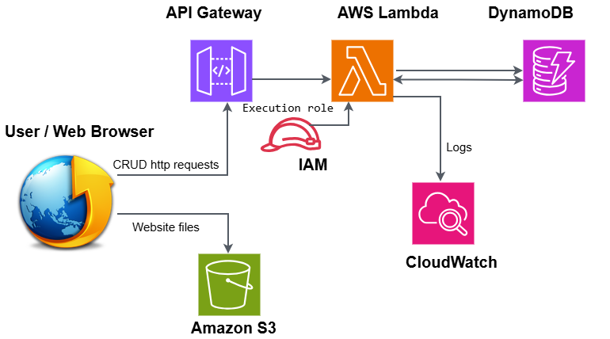

# AWS Serverless CRUD Task Manager

A hands-on cloud project that builds and deploys a task management web application using AWS serverless services. Users can create, view, update, complete and delete tasks through a web interface, with the data stored in a real database in the cloud.

The project was built in phases, with a focus on architecture, security, testing, troubleshooting and cost management. Everything ran on the AWS free tier at a total cost of **USD 0.00**.

**Project status:** Complete. All AWS resources were deleted after testing and documentation, so there is no live demo. The code, screenshots and documents in this repository show what was built and verified.



---

## Architecture



| Component | Role |
|---|---|
| **Amazon S3** | Hosts the static frontend (HTML, CSS, JavaScript) as a website |
| **Amazon API Gateway** | HTTP API that receives requests from the browser and forwards them to Lambda |
| **AWS Lambda (Python 3.13)** | Processes CRUD operations and validates input |
| **Amazon DynamoDB** | Stores task records in the `Tasks` table |
| **AWS IAM** | Execution role giving Lambda least-privilege access |
| **Amazon CloudWatch** | Lambda logs for monitoring and troubleshooting |

All resources were deployed in `eu-central-1` (Frankfurt).

### How a request flows

1. The user opens the website, which is served from Amazon S3.
2. When the user adds, edits or deletes a task, the browser sends an HTTP request to API Gateway.
3. API Gateway passes the request to the Lambda function.
4. Lambda validates the request and reads or writes the item in DynamoDB.
5. Lambda returns a JSON response, and the page updates.

---

## Features

- Create, list, view, update and delete tasks
- Mark tasks as completed
- Filter tasks in the interface
- Input validation in the backend (bad requests get a clear 400 error)
- Correct handling of missing tasks (404 instead of a crash)
- CORS restricted to the project's own website
- Throttling on the API to limit abuse

---

## API Design

| Method | Path | Purpose | Success | Errors |
|---|---|---|---|---|
| POST | `/tasks` | Create a task | 201 | 400, 500 |
| GET | `/tasks` | List all tasks | 200 | 500 |
| GET | `/tasks/{id}` | Get one task | 200 | 404, 500 |
| PUT | `/tasks/{id}` | Update a task | 200 | 400, 404, 500 |
| DELETE | `/tasks/{id}` | Delete a task | 204 | 404, 500 |

---

## Data Model

DynamoDB table: **`Tasks`**, partition key **`id`** (String).

| Attribute | Type | Notes |
|---|---|---|
| `id` | String | UUID, generated by the backend |
| `title` | String | Required, max 200 characters |
| `description` | String | Optional, max 2000 characters |
| `priority` | String | `low`, `medium` or `high` |
| `dueDate` | String | `YYYY-MM-DD` or empty |
| `completed` | Boolean | `true` or `false` |
| `createdAt` | String | ISO 8601 timestamp, set by the backend |
| `updatedAt` | String | ISO 8601 timestamp, set by the backend |

Only the partition key is defined on the table. DynamoDB is schemaless, so the other attributes are written with each item. The frontend shows completion as "pending" or "completed", and its storage layer (`taskApi` in `app.js`) translates this to the API's `completed` boolean.

---

## Security

- **Least privilege:** the Lambda role can perform only five DynamoDB actions (`PutItem`, `GetItem`, `UpdateItem`, `DeleteItem`, `Scan`) on the `Tasks` table only, plus writing its own CloudWatch logs. No `*` resources.
- **Restricted CORS:** the API accepts browser requests only from the project's S3 website.
- **Input validation:** only allowed fields can be set; the client cannot overwrite `id`, `createdAt` or `updatedAt`.
- **No leaked internals:** database errors return a generic 500 to the client, with details only in CloudWatch Logs.
- **No secrets in the repository:** the AWS account ID is masked in committed files and screenshots.

---

## Cost Control

| Area | Choice |
|---|---|
| Billing | Zero-spend budget alert in AWS Budgets |
| DynamoDB | Provisioned 1 RCU / 1 WCU, auto scaling off (covered by the free tier; on-demand is not) |
| Lambda | 128 MB memory, 3-second timeout |
| API Gateway | HTTP API (cheaper than REST API) with throttling: 10 requests/second, burst 20 |
| Region | Everything in one region, so no cross-region data transfer |

Final bill for the project: **USD 0.00**. All resources were deleted afterwards in the order described in [cost-control.md](docs/cost-control.md).

---

## Testing

The Lambda function was tested directly in the AWS console with test events ([test-events.md](docs/test-events.md)), and the full application was then tested end to end from the live website.

| Test | Expected | Result |
|---|---|---|
| Create a task | 201 + new item | Pass |
| List tasks | 200 + array | Pass |
| Get one task | 200 + item | Pass |
| Update a task | 200, `completed: true`, new `updatedAt` | Pass |
| Delete a task | 204, item removed from table | Pass |
| Create with no title | 400 | Pass |
| Create with invalid JSON | 400 | Pass |
| Get an unknown id | 404 | Pass |
| Update an unknown id | 404 | Pass |
| CORS request from the S3 website | Allowed | Pass |
| Full CRUD from the live website | Works end to end | Pass |

---

## Screenshots

| Screenshot | What it shows |
|---|---|
| [Frontend](docs/screenshots/frontend-preview.png) | The task manager interface |
| [S3 hosting](docs/screenshots/s3-hosting.png) | Static website hosting enabled on the bucket |
| [DynamoDB table](docs/screenshots/dynamodb-table.png) | The `Tasks` table |
| [IAM role](docs/screenshots/iam-role.png) | `TaskManagerLambdaRole` |
| [IAM policy](docs/screenshots/iam-role-policy.png) | Least-privilege inline policy |
| [Lambda overview](docs/screenshots/lambda-overview.png) | Function with API Gateway trigger and environment variables |
| [API Gateway routes](docs/screenshots/api-gateway-routes.png) | All five routes |
| [API Gateway CORS](docs/screenshots/api-gateway-cors.png) | CORS limited to the S3 website |
| [Create task](docs/screenshots/create-task.png) | Creating a task |
| [Update task](docs/screenshots/update-task.png) | Updating a task |
| [Delete task](docs/screenshots/delete-task.png) | Deleting a task |
| [404 test](docs/screenshots/lambda-404-test.png) | Correct response for a task that doesn't exist |
| [Billing](docs/screenshots/free-tier-usage.png) | Total charges USD 0.00 |

---

## Troubleshooting and Lessons Learned

Real problems met during the build and how they were solved:

| Problem | Cause | Fix |
|---|---|---|
| DynamoDB console error `Expected '{'` when creating an item | The editor was in "DynamoDB JSON" mode, which expects typed values like `{"S": "..."}` | Switched the editor to plain JSON view |
| DynamoDB error `Partition key attribute id must be non-empty` | A leftover template with an empty `id` was still in the editor | Cleared the template fully before pasting the item |
| DynamoDB capacity mode | On-demand capacity is not covered by the always-free tier | Used provisioned 1 RCU / 1 WCU with auto scaling off |
| A route was created as `OPTIONS /tasks/{id}` instead of `GET /tasks/{id}` | Wrong method picked in the dropdown | Edited the route to the correct method and retested |
| Lambda test showed "succeeded" but the task wasn't found | The function handles errors and returns normally | Learned to check `statusCode` in the response details, not just the green banner |
| Chrome refused pasted code in DevTools when testing CORS | Chrome blocks pasting into the console by default | Typed `allow pasting` first, then pasted the whole script |

---

## Repository Structure

```
aws-serverless-crud-task-manager/
├── README.md
├── frontend/              # Static web app, deployed to Amazon S3
│   ├── index.html
│   ├── styles.css
│   └── app.js
├── backend/
│   └── lambda_function.py # Python Lambda function for all routes
└── docs/
    ├── architecture/      # Architecture diagram
    ├── iam/               # IAM policy (account ID masked) and explanation
    ├── screenshots/       # Evidence from each phase
    ├── s3-hosting.md
    ├── dynamodb.md
    ├── lambda.md
    ├── api-gateway.md
    ├── test-events.md
    └── cost-control.md
```

### Detailed documentation

- [S3 hosting](docs/s3-hosting.md)
- [DynamoDB](docs/dynamodb.md)
- [IAM](docs/iam/README.md)
- [Lambda](docs/lambda.md)
- [API Gateway](docs/api-gateway.md)
- [Test events](docs/test-events.md)
- [Cost control and cleanup](docs/cost-control.md)

---

## Project Roadmap

- [x] Create the GitHub repository and document the plan
- [x] Phase 1: Build the frontend
- [x] Phase 2: Create the DynamoDB table
- [x] Phase 3: Create the IAM role with least-privilege permissions
- [x] Phase 4: Implement and test the Lambda function
- [x] Phase 5: Configure API Gateway routes, CORS and throttling
- [x] Phase 6: Connect the frontend to the backend
- [x] Phase 7: Host the frontend on Amazon S3
- [x] Phase 8: Test, document and clean up AWS resources

---

## Possible Improvements

- Add user sign-in with Amazon Cognito, so each user sees only their own tasks
- Serve the website over HTTPS with Amazon CloudFront
- Define the infrastructure as code (AWS SAM or Terraform) instead of creating it in the console
- Replace `Scan` with a `Query` on a secondary index for larger data sets
- Add a CI/CD pipeline with GitHub Actions to deploy changes automatically

---

## Technology Stack

Amazon S3 · Amazon API Gateway · AWS Lambda · Python · Amazon DynamoDB · AWS IAM · Amazon CloudWatch · HTML, CSS and JavaScript · Git and GitHub
