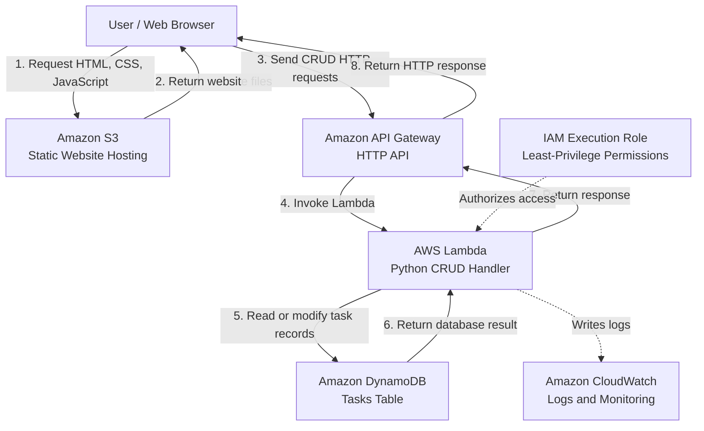

# AWS Serverless CRUD Task Manager

## 1. Project Overview

The AWS Serverless CRUD Task Manager is a web application that allows users to create, view, update, and delete tasks.

The project uses AWS managed and serverless services to build a simple application without managing servers.

### Project Objectives

- Build and host a static web frontend.
- Create RESTful API endpoints for CRUD operations.
- Use AWS Lambda with Python to implement application logic.
- Store task records in Amazon DynamoDB.
- Apply least-privilege IAM permissions.
- Use Amazon CloudWatch to monitor application logs.
- Practice cost-conscious AWS resource management.

## 2. Architecture Diagram



## 3. AWS Services and Responsibilities

| AWS Service | Responsibility |
|---|---|
| Amazon S3 | Hosts the static frontend files, including HTML, CSS, and JavaScript. |
| Amazon API Gateway | Exposes HTTP endpoints and routes requests to Lambda. |
| AWS Lambda | Runs Python code to process CRUD operations. |
| Amazon DynamoDB | Stores task records in a NoSQL database. |
| AWS IAM | Controls the permissions granted to Lambda. |
| Amazon CloudWatch | Collects Lambda logs for troubleshooting and monitoring. |

## 4. Application Request Flows

### Flow A: Loading the Website

1. The user opens the website in a browser.
2. The browser requests the static website files from Amazon S3.
3. S3 returns the files.
4. The browser displays the task manager interface.

### Flow B: Managing Tasks

1. The user performs an action, such as adding a task.
2. The frontend JavaScript sends an HTTP request to API Gateway.
3. API Gateway invokes the Lambda function.
4. Lambda validates the request and performs the required database operation.
5. DynamoDB returns the operation result.
6. Lambda returns a response through API Gateway.
7. The browser displays the result.

**Important:** S3 serves the website files. After the website loads, CRUD requests go directly from the browser to API Gateway.

## 5. API Endpoints

| HTTP Method | Route | Operation |
|---|---|---|
| POST | `/tasks` | Create a task |
| GET | `/tasks` | Retrieve all tasks |
| GET | `/tasks/{id}` | Retrieve a specific task |
| PUT | `/tasks/{id}` | Update a task |
| DELETE | `/tasks/{id}` | Delete a task |

The `{id}` path parameter identifies a particular task.

## 6. DynamoDB Data Model

**Table name:** `Tasks`

**Partition key:** `id` — String

Example task item:

```json
{
  "id": "task-101",
  "title": "Learn AWS Lambda",
  "description": "Build a Python CRUD handler",
  "completed": false
}
```

Each task has a unique identifier. The `completed` attribute records whether the task is finished.

## 7. Security Considerations

- Follow the principle of least privilege for IAM permissions.
- Grant Lambda only the DynamoDB permissions it needs.
- Validate incoming requests in Lambda.
- Do not store secrets in frontend JavaScript or expose AWS credentials.
- Configure API CORS settings to allow the intended frontend origin.
- The initial learning version may use an unauthenticated API. It must contain only non-sensitive test data and should not be treated as production-ready.
- Add authentication and authorization before using the application with real users or private data.

## 8. Cost Management

- Review AWS pricing and the account's current billing arrangements before creating resources.
- Use small test datasets and limited request volumes.
- Avoid unnecessary infrastructure such as NAT Gateways and VPCs in the initial version.
- Monitor AWS billing, credits, and service usage.
- Delete or disable resources when they are no longer needed, after checking their dependencies.

AWS service charges depend on the account plan, usage, and applicable pricing. This project is designed to keep the initial architecture simple, but zero cost is not guaranteed.

## 9. Implementation Roadmap

1. Document and review the architecture.
2. Create the DynamoDB `Tasks` table.
3. Create the Lambda execution role with appropriate permissions.
4. Implement and test the Python CRUD handler.
5. Create API Gateway routes and integrate Lambda.
6. Test the API operations.
7. Build the static frontend.
8. Host the frontend on Amazon S3 and connect it to the API.
9. Test the complete application.
10. Review security, costs, and cleanup.

## 10. Project Status

**Current phase:** Architecture documentation.

The AWS resources and application features will be implemented and tested in subsequent phases. The architecture describes the intended design; it does not indicate that the application has already been deployed.

